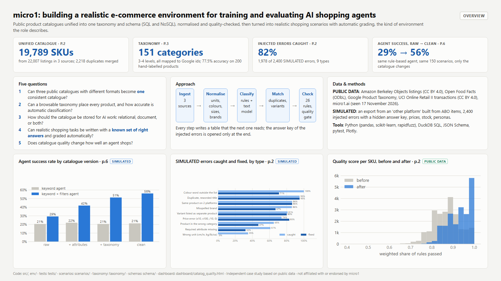

# micro1: building a realistic e-commerce environment for training and evaluating AI shopping agents

Public product catalogues unified into one taxonomy and schema (SQL and NoSQL), normalised and quality-checked, then turned into realistic shopping scenarios with automatic grading, the kind of environment the role describes.

*Independent case study based on public data · not affiliated with or endorsed by micro1.* The environment is a demonstration inspired by what the job offer describes; it is not a micro1 product or a product of its client. Real records are labelled **PUBLIC DATA**, invented ones **SIMULATED**.

**Report (8 pages):** [docs/micro1_ecommerce_catalog_environment_case_study.pdf](docs/micro1_ecommerce_catalog_environment_case_study.pdf) ·
**Dashboard:** [dashboard/catalog_quality.html](dashboard/catalog_quality.html) (download and open; works offline) ·
**Taxonomy:** [taxonomy/navigation_taxonomy.yaml](taxonomy/navigation_taxonomy.yaml) ·
**Scenarios:** [scenarios/](scenarios/) ·
**Notebook:** [notebooks/catalog_environment.ipynb](notebooks/catalog_environment.ipynb)



## Key results

| | Result |
|---|---|
| Unified catalogue | **19,789 SKUs** from 22,007 listings in 3 sources; 2,218 duplicates merged; mean quality score 0.87 → 0.93 (26 rules) |
| Taxonomy | **151 leaf categories** (3-4 levels), each mapped to a Google Product Taxonomy id; **77.5 %** of 200 hand-labelled products in the right leaf (82.4 % without ambiguous items, 87.5 % right department) |
| Injected errors | **82 %** of 2,400 SIMULATED errors caught (1,978), 77 % fixed in the clean catalogue; wrong units remain the hardest (35 %) |
| Agents | The same rule-based agent succeeds on **29 %** of the 150 scenarios with the raw listings and **56 %** with the clean catalogue |

## What is in the repository

| Folder | Content |
|---|---|
| `src/catalog/` | ingestion, normalisation (units, colours, sizes, brands), classification, duplicates and variants, quality rules (`rules.yaml`), error injection |
| `taxonomy/` | navigation taxonomy (YAML, source of truth), categories with Google ids, source-category mapping, attribute templates, brand mapping, hand checks (200 labels, 50 duplicate pairs) |
| `schema/` | `schema.sql` (DuckDB, PostgreSQL notes), `product.schema.json` (JSON Schema), `mongo_validator.json`, `scenario.schema.json`, a sample document |
| `scenarios/` | 150 scenarios `S001.json` ... `S150.json`, seven types, difficulty 1-5 |
| `env/` | the shop (`shop.py`), automatic grading (`grader.py`), two reference agents (`agents.py`), `run_baselines.py` |
| `tests/` | pytest: normalisation rules, environment, grader, every scenario answerable (or designed to have no answer) |
| `docs/` | report, catalogue standards, taxonomy guide, metadata spec, scenario authoring guide, workflow |
| `data/processed/` | clean catalogue, raw-listing view with lineage, JSON documents (ODbL 1.0, see Licences) |
| `data/outputs/` | every table and figure behind the report |

## Methods

- **Sources**: Amazon Berkeley Objects listings (13,000 sampled, seed 42, phone cases capped), Open Food Facts (UK/US products in 22 food categories, official search API), and a SIMULATED export from an "other platform" built from ABO items with its own formats (2,400 rows, two thirds already in the ABO sample).
- **Normalisation**: SI units (cm, g, ml), 16 controlled colours with multilingual synonyms, apparel / EU shoe / bed sizes, brand reference table with variant and fuzzy matching. Choices in [docs/CATALOG_STANDARDS.md](docs/CATALOG_STANDARDS.md).
- **Duplicates**: identifiers first, then title similarity ≥ 94 inside brand × department blocks with agreeing numbers; threshold chosen on 50 pairs checked by hand (precision 80 %, recall 89 % on that sample).
- **Classification**: source-category mapping and keyword rules, then a TF-IDF + logistic regression model; accuracy measured on 200 products labelled by hand from title and brand only.
- **Quality**: 26 rules, weighted score per SKU and per category, issues log, quality gate holding price errors back from the shop. 2,400 SIMULATED errors (9 types) are injected and their answer key is opened only by `src/evaluate_detection.py`.
- **Scenarios**: generated from the clean catalogue; personas and intents SIMULATED, basket sizes, quantities and seasonality calibrated on UCI Online Retail II invoices.
- **Agents**: plain Python baselines (keywords; keywords + filters), no language model, run on four versions of the catalogue that add one fix at a time.
- **AI-assisted workflow**: I used Claude, mainly to write scripts faster. I drove the project: I defined the questions, chose and validated the data sources, made the analytical decisions and checked every result.

## How to rerun

Python 3.13, Microsoft Edge (headless, for the PDF). About 25 minutes in total; the catalogue build takes about 6 minutes.

```bash
pip install -r requirements.txt
python src/download_data.py
python src/build_catalog.py
python src/build_taxonomy.py
python src/build_schema.py
python src/evaluate_detection.py
python src/build_scenarios.py
pytest
python env/run_baselines.py
python src/build_dashboard.py
python src/build_notebook.py
python src/build_pdf.py
```

MongoDB is optional: `data/processed/catalog_documents.jsonl` (one document per line) loads with `mongoimport --collection products --file data/processed/catalog_documents.jsonl`, with `schema/mongo_validator.json` as the collection validator. The pipeline itself validates every document with JSON Schema in Python.

## Sources and licences

- **Amazon Berkeley Objects (ABO)** listings: credit for the data to Amazon.com. Collins, J. et al. (2022). *ABO: Dataset and Benchmarks for Real-World 3D Object Understanding*. CVPR. Licence: CC BY 4.0. https://amazon-berkeley-objects.s3.amazonaws.com/index.html
- **Open Food Facts**: © Open Food Facts contributors, https://world.openfoodfacts.org. Database licence: Open Database License (ODbL 1.0); product content: Database Contents License. The files in `data/processed/` contain data derived from Open Food Facts and are therefore made available under the **ODbL 1.0** (share-alike); ABO-derived rows keep their CC BY 4.0 attribution.
- **Google Product Taxonomy** (version 2021-09-21, en-US): https://www.google.com/basepages/producttype/taxonomy-with-ids.en-US.txt, used for category ids and names.
- **schema.org/Product**: vocabulary used as a reference for field names.
- **UCI Online Retail II**: Chen, D. (2019). Online Retail II. UCI Machine Learning Repository, https://archive.ics.uci.edu/dataset/502/online+retail+ii. CC BY 4.0. Only aggregates are kept (no customer identifiers).
- **micro1.ai**: published facts only, quoted as stated by micro1, seen on 17 November 2026.
- Code: MIT licence.

Raw downloads (`data/raw/`) are not published; `src/download_data.py` rebuilds them.

## Limits

- Prices, stock, the second platform, the personas and the injected errors are SIMULATED; real error rates and shopper behaviour will differ.
- ABO is mostly Amazon private-label products: brand variety is lower than on an open marketplace.
- The hand labels (200 products, 50 pairs) come from one reviewer reading titles; ambiguous items are flagged rather than forced.
- The agents are simple rule-based baselines. They show what the catalogue allows, not what a frontier model can do.
- Wrong units are hard to detect from values alone (35 % caught); an automatic repair was tested and rejected because it changed more correct values than wrong ones.

---
Independent case study based on public data · not affiliated with or endorsed by micro1
